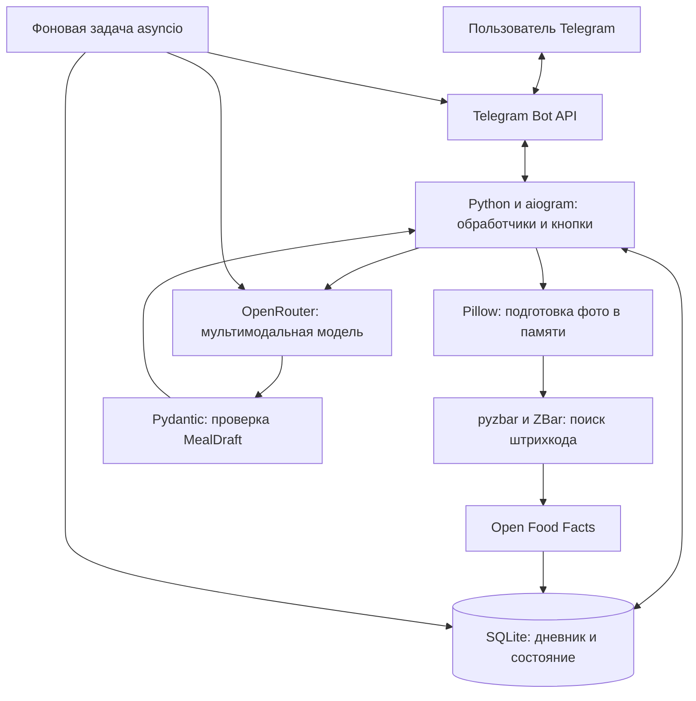

# NutriSnap AI

**Отчёт о реализации MVP Telegram-дневника питания.**

NutriSnap AI помогает учитывать питание через привычный чат: пользователь отправляет
фото блюда, описание или штрихкод, проверяет оценку калорий и БЖУ и сохраняет приём пищи.
Бот собирает дневные итоги и формирует недельный отчёт. Интерфейс и ответы ориентированы
на русский язык.

Проект реализован по заданным функциональным требованиям с адаптацией архитектуры
к небольшому серверу с **2 ГБ оперативной памяти и 2 vCPU**. Основной сценарий:

**Фото / текст / штрихкод → оценка КБЖУ → проверка и правка → принятие → дневник.**

## 1. Цель и объём выполненной работы

Цель MVP — сократить ручной ввод при ведении дневника питания. Вместо поиска продуктов
в большом каталоге пользователь описывает еду или фотографирует её, а затем подтверждает
полученную оценку.

Реализованы серверная часть Telegram-бота, интеграция с внешним AI, обработка штрихкодов,
хранение состояния и записей, расчёт итогов, редактирование сохранённых приёмов пищи,
плановые отчёты и автоматическая очистка служебных сообщений.

Платежи, подписки, персональный расчёт норм, голосовой ввод, отдельное веб-приложение
и нативное мобильное приложение в эту реализацию не входили.

## 2. Соответствие функциональным требованиям

| Требование | Результат реализации |
|---|---|
| FR-1. Оценка КБЖУ по фото | Изображение обрабатывается в памяти, уменьшается и передаётся мультимодальной модели через OpenRouter. Ответ проверяется по схеме `MealDraft`. |
| FR-1. Текст и фото с подписью | Учитываются описание, ингредиенты и указанный вес. Карточка содержит название, порцию, калории, белки, жиры, углеводы и пояснение оценки. |
| FR-1. Штрихкод | EAN-8, EAN-13 и UPC-A распознаются локально. Проверяется контрольная цифра, данные продукта запрашиваются из Open Food Facts и кэшируются. |
| FR-2. Подтверждение | Запись попадает в дневные итоги только после «Принять». Повторное нажатие не добавляет второй приём пищи. |
| FR-2. Правка до принятия | Пользователь отправляет уточнение текстом. AI пересчитывает ту же карточку. |
| FR-2. Чистый чат | Удаляются временное «Распознаю…», команды и устаревшие карточки. Ошибки и вызвавшие их сообщения исчезают через 15 секунд, если Telegram разрешает удаление. |
| FR-3. Дневной дашборд | Суммируются только подтверждённые записи. Прогресс-бары сравнивают калории и БЖУ с общими нормами. |
| FR-3. Граница суток | День дневника начинается в 04:00 по `Europe/Moscow`. Счётчик успешных распознаваний использует календарную дату МСК. |
| FR-3. Недельный AI-отчёт | В воскресенье после 20:00 МСК выбираются записи за последние семь суток и формируется текстовый отчёт по агрегатам. |
| Защита стоимости | Есть лимит успешных распознаваний пользователя и отдельный общий бюджет AI-запросов. Платные модели требуют явного разрешения в настройках. |
| Сохранение состояния | Профили, черновики, режим правки, записи, лимиты и отчёты хранятся в SQLite. |
| Срок хранения | Записи и отчёты очищаются по сроку хранения, по умолчанию 90 дней. Черновики действуют 24 часа, кэш продуктов — 30 дней. |

### Дополнительные доработки

- `/today` показывает дневник внизу чата, даже если значения не изменились.
  Предыдущий дашборд удаляется по возможности.
- Принятые записи текущего дня можно исправить или удалить через кнопку
  **«Изменить записи»** в дашборде.
- Удаление приёма пищи требует отдельного подтверждения.
- При правке принятой записи исходные значения остаются в итогах до принятия
  новой карточки. Отмена и ошибка AI не меняют сохранённый приём пищи.
- Подтверждённая правка заменяет исходную запись с сохранением времени приёма пищи.
  Транзакция исключает двойной учёт.
- Добавлена диагностика сетевых ошибок, квот, отказов авторизации, пустого ответа
  и исчерпания лимита токенов. Фото, ответы модели и ключи не включаются в сообщения
  диагностики приложения.

## 3. Архитектура

Приложение построено как один асинхронный Python-процесс. Он получает Telegram updates,
обрабатывает пользовательские действия и выполняет фоновые задачи. Вычисления модели
происходят у внешнего AI-провайдера.

| Модуль | Назначение |
|---|---|
| `bot.py` | Команды, inline-кнопки, карточки, дневник, редактор записей и очистка чата. |
| `ai.py` | Запросы в OpenRouter, food-only prompt, обработка ошибок и повтор исправления JSON. |
| `food.py` | Подготовка изображений, декодирование штрихкодов, порции и Open Food Facts. |
| `db.py`, `schema.sql` | Хранение, транзакции, лимиты, подтверждение, правки и очистка данных. |
| `domain.py` | Модель `MealDraft`, граница суток и отображение КБЖУ. |
| `jobs.py` | Плановые отчёты, очистка по сроку хранения и heartbeat. |
| `config.py` | Типизированные настройки и проверка конфигурации. |
| `healthcheck.py`, `backup.py` | Проверка локальной БД и согласованное резервное копирование SQLite. |

## 4. Выбор технологий и изменения исходной архитектуры

| Компонент | Исходное решение | Реализовано | Обоснование и компромисс |
|---|---|---|---|
| Telegram | aiogram 3.x | aiogram 3.x | Сохранены асинхронный подход, маршрутизация команд и обработка callback-кнопок. |
| Основная БД | PostgreSQL | SQLite + aiosqlite, WAL | Исключён отдельный сервис СУБД. Для одного экземпляра MVP доступны транзакции, индексы, внешние ключи и постоянное хранение. Рост до нескольких экземпляров потребует пересмотра хранения. |
| Состояние диалога | Redis FSM с TTL | Черновики и режим правки в SQLite | Уменьшено число сервисов и потребление памяти. Состояние переживает перезапуск; срок действия проверяется при чтении, просроченные данные удаляются фоновой задачей. |
| AI | Прямой Gemini API | OpenRouter через HTTPX | Модель выбирается настройкой без переписывания обработчиков. Доступны бесплатный маршрут и конкретные мультимодальные модели. Скорость и доступность зависят от внешнего провайдера. |
| Обработка фото | pyzbar + OpenCV | Pillow + pyzbar + системный ZBar | Pillow достаточно для чтения, ориентации и уменьшения фото; ZBar декодирует штрихкоды. Зависимость OpenCV не потребовалась. |
| Планирование | APScheduler | Фоновая задача asyncio | Для очистки и одного недельного расписания достаточно периодической проверки. Результаты формирования и отправки отчётов сохраняются в БД. |
| Получение обновлений | Long polling | Long polling | Сохранена схема без отдельного HTTP-сервера и webhook-обработчика. |
| Упаковка | Несколько сервисов Docker Compose | Один контейнер и постоянный том | Меньше постоянно работающих процессов; потребление ресурсов ограничено конфигурацией контейнера. |

Сохранены функциональные сценарии MVP, а инфраструктура упрощена для одного небольшого
сервера. Решение рассчитано на один экземпляр приложения, а не на распределённую
обработку большого потока пользователей.

### Работа AI за пределами сервера

На сервере не загружается нейросеть и не выполняется локальный inference. Его задачи —
получить сообщение, подготовить изображение, вызвать внешний API, проверить ответ
и сохранить результат. Поэтому не требуются GPU и большой объём RAM.

В ходе интеграционной проверки использована `nvidia/nemotron-3.5-super-vl:free`;
программное значение по умолчанию — `openrouter/free`. Конкретный ID относится
к конфигурации, а не зашит в обработчики. Автоматического перехода на платную
модель при ошибке нет. Бесплатный API не обеспечивает гарантированных квот и задержки.

### Исправление совместимости с Nemotron

Реальный тест выявил ответ HTTP 200 с пустым `content`: все 900 выходных токенов
были использованы для рассуждений, `finish_reason` имел значение `length`.
В запрос добавлено `reasoning.enabled=false`. В повторном тесте на синтетическом
изображении получена валидная структура оценки еды. Пустые ответы и исчерпание
токенов теперь диагностируются отдельно от сетевых ошибок.

## 5. Как функционирует бот

### Распознавание и сохранение

1. Пользователь отправляет текст, фото, фото с подписью или штрихкод с весом порции.
2. Проверяются тип входа, размер и лимит успешных распознаваний пользователя.
3. Фото читается в память, ориентируется и уменьшается до 1280 пикселей по большей стороне.
   Сырые изображения в рабочую БД и файлы приложения не записываются.
4. При обнаружении штрихкода используются кэш и Open Food Facts. Иначе запрос
   передаётся мультимодальной модели через OpenRouter.
5. Ответ проверяется: название и пояснение ограничены по длине, масса должна быть
   положительной, КБЖУ — конечными неотрицательными числами в заданных диапазонах.
6. При неверном JSON допускается одна попытка исправить формат. При отказе API
   не запускается бесконечная цепочка повторов.
7. Успешная оценка сохраняется как черновик. Карточка содержит кнопки
   «Принять», «Изменить» и «Отменить».
8. Только после принятия запись участвует в итогах дня.

Общий prompt ограничивает назначение модели едой и КБЖУ. Вход пользователя рассматривается
как данные, а не инструкции сменить роль. Строки модели экранируются перед вставкой
в HTML-сообщения Telegram. Prompt не гарантирует защиту от всех jailbreak.

### Дашборд и исправления

Дашборд суммирует подтверждённые записи по ключу дня и сравнивает результат с общими
нормами. Нормы задаются конфигурацией; персонального расчёта в MVP нет.

Обычно бот редактирует существующий дашборд. `/today` повторно показывает его внизу
чата. В редакторе можно просмотреть список приёмов пищи, выбрать нужный, подготовить
новую оценку либо подтвердить удаление.

Правка принятой записи оформляется отдельным черновиком, связанным с исходной записью
через `meal_revisions`. До принятия исходная запись остаётся подтверждённой.
При принятии одной транзакцией обновляется её содержимое и закрывается черновик правки.
Редактор проверяет владельца, статус и принадлежность записи текущему дню.

### Штрихкоды

Поддержаны изображение и цифровое представление EAN/UPC. После проверки контрольной
цифры бот получает название и КБЖУ на 100 г из Open Food Facts. При указанном весе
значения пересчитываются на порцию; без веса используется 100 г с пояснением.
Кэш действителен 30 дней. При отсутствии данных предлагается описание продукта
или фото названия.

Данные продуктов используются с указанием источника
[Open Food Facts, ODbL](https://openfoodfacts.github.io/openfoodfacts-server/api/).

### Недельный отчёт

После 20:00 МСК в воскресенье выбирается фиксированный семидневный интервал.
В AI передаются дневные суммы КБЖУ и число записей. Названия блюд и исходные фото
для отчёта не требуются. Сгенерированный текст сохраняется до отправки.

Неудачная генерация или отправка повторяется раз в 15 минут до конца воскресенья.
Если текст уже сохранён, новая генерация для повторной доставки не нужна.
Успешная отправка отмечается в БД.

### Очистка чата

Команды удаляются после обработки. «Распознаю…» удаляется после завершения запроса.
Ошибки и связанные с ними входные сообщения удаляются через 15 секунд. Очистка
выполняется best-effort: отказ Telegram не отменяет сохранение данных и не останавливает
обработчик. При штатной остановке ожидающие удаления уведомления очищаются перед
закрытием бота.

## 6. Хранение и целостность

| Таблица | Назначение |
|---|---|
| `users` | Telegram ID, общие нормы, дата и число успешных распознаваний. |
| `meals` | Время и день приёма пищи, источник, нормализованная оценка, статус, срок действия и ID карточки. |
| `meal_revisions` | Связь черновика правки с принятой записью. |
| `dashboards` | ID сообщения дашборда на пользователя и день. |
| `barcode_cache` | Данные продукта и дата получения из Open Food Facts. |
| `weekly_reports` | Отчёт, период и признак отправки. |
| `api_usage` | Общий счётчик обращений к AI по датам UTC. |

Транзакции защищают подтверждение, квоты и замену записи. Повторное подтверждение
не увеличивает итоги. Внешние ключи обеспечивают каскадное удаление связанных данных.
Локальные операции с БД сериализованы; используются WAL и ограниченное ожидание блокировки.

Текущая версия схемы — **2**. Таблица связей правок добавляется при открытии существующей
базы версии 1 с сохранением профилей и приёмов пищи. Хранится нормализованный JSON
оценки, а не полный необработанный ответ AI.

## 7. Выполнение нефункциональных требований

| Направление | Реализованные меры и границы |
|---|---|
| Ограничение ресурсов | Один процесс, отсутствие локальной LLM, PostgreSQL и Redis; до двух одновременно обрабатываемых запросов по умолчанию. При перегрузке запрос отклоняется до скачивания фото. |
| Ресурсы контейнера | Заданы 768 МБ памяти и 1,5 CPU, ограничение процессов, ротация логов, непривилегированный пользователь и файловая система приложения только для чтения. Это конфигурация, а не результат нагрузочного теста. |
| Ограничение входа | Текст до 1000 символов; JPEG/PNG/WEBP до 5 МБ и 16 мегапикселей. |
| Контроль стоимости | По умолчанию 15 успешных распознаваний/правок на пользователя за дату МСК, 45 AI-запросов на экземпляр за дату UTC и интервал 4 секунды между стартами AI-запросов. Ошибки и repair входят в общий бюджет. |
| Конфиденциальность | Фото обрабатываются в RAM. Для оценки они передаются внешнему AI-провайдеру через OpenRouter; политики сервисов действуют отдельно. Локальная конфигурация и ключи исключены из репозитория. |
| Срок хранения | Очистка записей и отчётов, проверка TTL черновиков, обновление кэша продуктов. Сохранён обработчик удаления профиля и данных; он не включён в меню команд. |
| Устойчивость | Проверка ответов, ограниченные повторы, атомарное подтверждение, сохранение состояния и отчётов, восстановление дашборда после удаления сообщения. |
| Наблюдаемость | Коды ошибок и ID AI-запросов без тел ответов; heartbeat и проверка доступности SQLite. |
| Локализация | Русские пользовательские сообщения и инструкции модели. Названия импортированных продуктов зависят от данных источника. |
| Задержка | Исходная цель p95 ≤ 8 секунд не подтверждена измерениями. Бесплатный внешний AI может отвечать медленнее; задан таймаут одного запроса. |

## 8. Проверка результата

Для приложения подготовлены **49 автоматизированных тестов**. На последней проверке
все тесты прошли, статическая проверка Ruff завершилась без замечаний.

Проверены:

- смена дня в 04:00 МСК и отличие от календарного лимита;
- схема JSON, диапазоны КБЖУ и экранирование строк;
- подтверждение, повторные нажатия и конкурентные операции;
- лимиты пользователя и общий бюджет AI;
- восстановление черновиков после повторного открытия БД;
- сроки хранения и каскадное удаление;
- подготовка фото, ошибки формата и кэш Open Food Facts;
- HTTP-ошибки, таймауты, потеря соединения и исправление JSON;
- пустой ответ после исчерпания токенов и безопасная диагностика;
- команды и callback-кнопки через Dispatcher aiogram;
- повторный `/today`, восстановление и очистка сообщений;
- правки принятых записей, отмена и удаление с пересчётом;
- проверка владельца и запрет редактирования завершённого дня;
- обновление существующей схемы базы;
- расписание, повторная доставка и исключение повторной генерации отчётов.

Автотесты используют временную БД и подменённые HTTP/Telegram-вызовы. Они проверяют
логику приложения, но не измеряют точность определения еды на произвольных реальных
фотографиях. Отдельно выполнен реальный запрос к OpenRouter с синтетическим изображением
для проверки исправления параметров Nemotron.

## 9. Ограничения результата

- Оценка порции и КБЖУ приблизительная; пользователь проверяет её перед принятием.
- Бесплатный AI зависит от доступности модели, провайдера и общей квоты ключа.
- Конфигурация рассчитана на один экземпляр. Для распределённой обработки потребуются
  общий лимитер и пересмотр хранения и получения updates.
- Если приложение не работало всё воскресенье после 20:00, отчёт не догоняется
  автоматически в понедельник.
- При аварии между доставкой отчёта и записью признака отправки возможна повторная
  доставка. После аварийного завершения могут остаться временные сообщения.
- Проверка работоспособности контролирует локальную задачу и БД, а не доступность
  Telegram или AI-провайдера.
- Удаление из рабочей БД не удаляет ранее сделанные резервные копии и данные,
  уже переданные внешним сервисам.

Реализован MVP с полным циклом учёта питания и последующего исправления записей.
Изменения технологий уменьшили число сервисов и сложность инфраструктуры, сохранив
постоянное хранение, подтверждение пользователем и расчёт дневных итогов.
